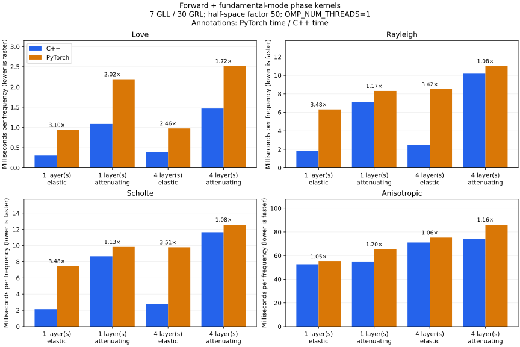

# C++ and PyTorch efficiency

The four comparisons cover Love, Rayleigh, Scholte, and fully anisotropic
waves. The primary workload is **forward plus phase kernels**: a fresh solve
followed by every fundamental-mode phase-kernel parameter row. Attenuating
cases also compute the wave inverse-Q kernels.



Bars show median milliseconds per frequency; lower is faster. Annotations
give PyTorch time divided by C++ time, so values above one favor C++.
Each panel compares one and four solid layers, with and without attenuation.
Scholte models also contain an acoustic surface layer.

## Measurement conditions

These CPU measurements use 7-node GLL elements, 30-node GRL elements, a
half-space factor of 50, and double precision. The native build uses Apple
Clang, modern Apple Accelerate, `SPECSWD_EGN_DOUBLE=ON`, and
`SPECSWD_REGULAR_SCHUR=ON`. Frequencies are 0.05 and 0.2 Hz at 25° azimuth.
Only `OMP_NUM_THREADS=1` is set; other thread pools use their defaults.
The saved measurements were collected on 25 October 2026 on macOS/Apple
Silicon with Python 3.12.15, PyTorch 2.14.1, and NumPy 2.5.4.

Each backend is warmed up once, followed by five samples with calibrated
batches and alternating backend order. Timings include mesh construction,
interpolation, assembly, eigensolving, mode selection, and requested kernels.
Model initialization, imports, correctness checks, file IO, and plotting are
excluded. The C++ API is called through the Python bindings.

Phase, group, and fundamental-mode phase/group kernels are checked between
backends before timing, including wave inverse-Q kernels when attenuating.
Agreement between backends is separate from convergence of the shared SEM
discretization. These timings describe this CPU, library, and model
configuration; they do not measure GPU performance or exact degeneracy.

## Reproduce

Build and install the current native extension, then run from the repository
root in the PyTorch environment:

```bash
for wave in love rayl scholte aniso; do
    OMP_NUM_THREADS=1 python -m specd.torch.benchmark \
        --waves "$wave" --layers 1 4 --frequencies .05 .2 \
        --workloads forward phase_kernel group group_kernel \
        --repeats 5 --warmup 1 --output "specd/torch/benchmarks/$wave"
done
OMP_NUM_THREADS=1 python misc/plot_benchmarks.py
```

Each of the four result directories contains a Markdown report, a runtime
ratio figure, and JSON with raw samples, model arrays, correctness errors,
extension identity, compiler settings, and library/thread metadata.
The reports also retain forward, group-velocity, and group-kernel workloads.
Their kernel timings already include the forward solve; do not add the
separate forward time.

Reports and raw measurements:
[Love](https://github.com/nqdu/SpecSWD/tree/main/specd/torch/benchmarks/love),
[Rayleigh](https://github.com/nqdu/SpecSWD/tree/main/specd/torch/benchmarks/rayl),
[Scholte](https://github.com/nqdu/SpecSWD/tree/main/specd/torch/benchmarks/scholte),
[anisotropic](https://github.com/nqdu/SpecSWD/tree/main/specd/torch/benchmarks/aniso).
