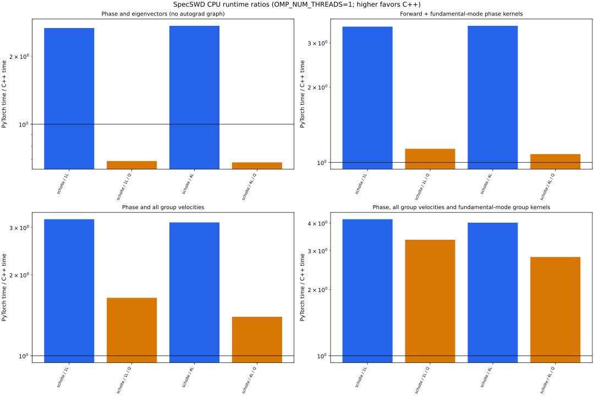

# PyTorch versus C++ efficiency

Measured 2026-10-25T09:26:50.018342+00:00 on macOS-26.6.2-arm64-arm-64bit (arm64).
Python 3.12.15, PyTorch 2.14.1, NumPy 2.5.4; OMP_NUM_THREADS=1; other thread pools use their defaults.

Native compiler: `/usr/bin/c++`. Effective C++ flags: `-g -Wall -DEIGEN_DONT_PARALLELIZE -DEIGEN_USE_LAPACKE -O3 -DNDEBUG -march=native -std=gnu++17 -fPIC -fvisibility=hidden -flto`.

C++ LAPACK backend: `Apple Accelerate (modern, 32-bit LAPACK integers)`.

C++ ordinary Schur option: `ON`.

The primary comparison workload is `phase_kernel`: a fresh forward solve followed by fundamental-mode phase kernels. Its measured time includes both operations; separate forward timings must not be added to it.

The C++ backend is called through its existing pybind11/Python interface. Each timing includes mesh creation, interpolation, assembly, eigensolving, mode filtering and the requested output/derivatives. Model initialization, imports, correctness checks, IO and plotting are excluded. Both backends use float64/complex128, 7-node GLL, 30-node GRL and a 50-wavelength half-space.

Phase-only timings request only eigenvalues with `only_phase=True`. Forward timings include eigenvectors in both implementations. Both disable autograd graph construction in PyTorch. Other tasks build a fresh graph/solve at every frequency. Kernel tasks return every model-parameter derivative for mode 0; attenuating cases include both velocity and wave inverse-Q kernels. Group tasks evaluate every retained mode; group-kernel tasks additionally compute the radial group kernels of mode 0.

Frequencies: [0.05, 0.2] Hz; azimuth 25.0 degrees. Each entry is the median of 5 repeated samples, divided by the number of frequencies and calibrated batch iterations. Backend order alternates between repeats; garbage collection runs outside timed regions. The ratio is PyTorch time / C++ time, so values above 1 favor C++.

Physical DOF and retained mode counts are recorded per frequency in the JSON. Both anisotropic eigensystems have twice the physical DOF. The C++ implementation uses QZ/Schur; PyTorch uses dense eigensolvers and higher-order autograd. These are measurements of the current implementations, rather than a general limit on either language or GPU performance.

All cases first passed phase, group and both kernel comparisons. Native fluid kernel rows are combined into their corresponding original torch parameter rows before validation. CPU timing only; no GPU or peak-memory comparison was performed.

## Runtime ratio ranges

Ranges span the measured layer counts and attenuation settings. Every ratio is PyTorch / C++ time; below 1 favors PyTorch.

| Wave | Phase and eigenvectors (no autograd graph) | Forward + fundamental-mode phase kernels | Phase and all group velocities | Phase, all group velocities and fundamental-mode group kernels |
| --- | ---: | ---: | ---: | ---: |
| scholte | 0.68–2.72× | 1.08–3.51× | 1.40–3.22× | 2.81–4.17× |



## Phase and eigenvectors (no autograd graph)

| Wave | Attenuation | Solid layers | Physical DOF range | Modes | C++ ms/frequency | PyTorch ms/frequency | Ratio |
| --- | --- | ---: | ---: | ---: | ---: | ---: | ---: |
| scholte | no | 1 | 78–114 | 2–5 | 2.111 | 5.625 | 2.7× |
| scholte | yes | 1 | 78–114 | 12–13 | 8.597 | 5.909 | 0.7× |
| scholte | no | 4 | 114–114 | 2–5 | 2.774 | 7.557 | 2.7× |
| scholte | yes | 4 | 114–114 | 12–13 | 11.568 | 7.841 | 0.7× |

## Forward + fundamental-mode phase kernels

| Wave | Attenuation | Solid layers | Physical DOF range | Modes | C++ ms/frequency | PyTorch ms/frequency | Ratio |
| --- | --- | ---: | ---: | ---: | ---: | ---: | ---: |
| scholte | no | 1 | 78–114 | 2–5 | 2.143 | 7.464 | 3.5× |
| scholte | yes | 1 | 78–114 | 12–13 | 8.676 | 9.832 | 1.1× |
| scholte | no | 4 | 114–114 | 2–5 | 2.791 | 9.788 | 3.5× |
| scholte | yes | 4 | 114–114 | 12–13 | 11.649 | 12.571 | 1.1× |

## Phase and all group velocities

| Wave | Attenuation | Solid layers | Physical DOF range | Modes | C++ ms/frequency | PyTorch ms/frequency | Ratio |
| --- | --- | ---: | ---: | ---: | ---: | ---: | ---: |
| scholte | no | 1 | 78–114 | 2–5 | 2.161 | 6.957 | 3.2× |
| scholte | yes | 1 | 78–114 | 12–13 | 8.721 | 14.327 | 1.6× |
| scholte | no | 4 | 114–114 | 2–5 | 2.816 | 8.822 | 3.1× |
| scholte | yes | 4 | 114–114 | 12–13 | 11.724 | 16.373 | 1.4× |

## Phase, all group velocities and fundamental-mode group kernels

| Wave | Attenuation | Solid layers | Physical DOF range | Modes | C++ ms/frequency | PyTorch ms/frequency | Ratio |
| --- | --- | ---: | ---: | ---: | ---: | ---: | ---: |
| scholte | no | 1 | 78–114 | 2–5 | 2.244 | 9.351 | 4.2× |
| scholte | yes | 1 | 78–114 | 12–13 | 8.882 | 29.848 | 3.4× |
| scholte | no | 4 | 114–114 | 2–5 | 2.942 | 11.823 | 4.0× |
| scholte | yes | 4 | 114–114 | 12–13 | 11.945 | 33.536 | 2.8× |

## Reproduce

Run from the repository root with the `specswd-torch` environment:

```bash
python -m specd.torch.benchmark --native-extension build/src/libswd/libswd.cpython-312-darwin.so --layers 1 4 --frequencies .05 .2 --workloads forward phase_kernel group group_kernel --repeats 5 --warmup 1 --output /tmp/specswd-current-benchmarks
```

A current native extension is required; `--native-extension` selects a separate build without replacing the installed one. The JSON includes extension identity, model arrays, raw timing samples, batch counts and correctness errors. Use `--help` to change frequencies, models, layer counts, repeats or threads.
